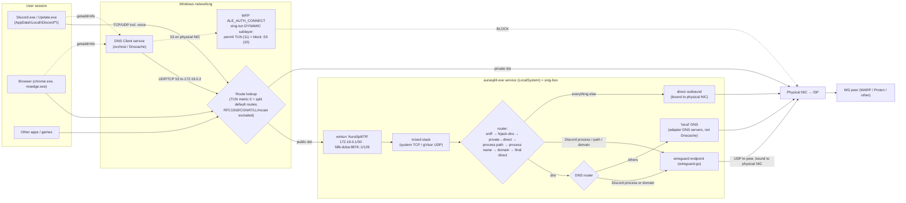

# Phase 3 – Architecture and Network Audit (Windows networking)

Date: 2026-11-21 · Scope: `aurasplit` (module `aurasplit`) as it is in the working tree, sing-box `v1.14.4`,
sing-tun `v0.9.7-0.20261023115432-040db71fcd33`, sing `v0.9.7-0.20261023115459-5dc452e537bf` from the Go module cache.
Method: read-only source review. **Nothing was run on a real network, no TUN was opened, no service was installed.**
`ARCHITECTURE.md` / `README.md` were not used as evidence; every statement below points at code.

Legend used throughout:

* **IMPLEMENTED** – the behaviour exists in code (file:line given).
* **UNIT-TESTED** – a Go unit test exercises it (config structure, parsing or mocked control flow only).
* **NOT TESTED** – never observed on a real Windows network stack. This is the status of every packet-level claim.
* **UNCERTAIN** – my reading of Windows / third-party behaviour that I could not prove from source.

Paths: `AURA` = `<repo root>`, `SB` = `…\go\pkg\mod\github.com\sagernet\sing-box@v1.14.4`,
`ST` = `…\go\pkg\mod\github.com\sagernet\sing-tun@v0.9.7-0.20261023115432-040db71fcd33`, `SG` = `…\sagernet\sing@v0.9.7-…5dc452e537bf`.

---

## 1. What the code actually does

### 1.1 Executable entry points

Single binary `aurasplit.exe` (`cmd/aurasplit/main.go:29-84`). Commands (Turkish aliases in parentheses):

| Command | Elevation | Code | Effect |
|---|---|---|---|
| *(none)* | – | `main.go:33-40` | If started by SCM → `cmdService`; otherwise `setup`. |
| `setup` (`kurulum`) | self-elevates | `setup.go:28-207` | Interactive wizard: preflight, provider choice, `engine.Check`, stage profile, stop old service, copy exe to `%ProgramFiles%\AuraSplitTR`, install/update service, commit profile, start service. |
| `status` (`durum`) | none (details need admin) | `commands.go:23-99` | SCM state + tunnel-state file (validated by PID, process start time, heartbeat ≤ 90 s). |
| `start`/`stop`/`restart` | self-elevates | `commands.go:101-127` | SCM control. |
| `uninstall` (`kaldir`) | self-elevates | `commands.go:129-182` | Stop + delete service, event-log source; optionally delete data and install dir (tombstone + delete-on-reboot for the running exe). |
| `run [--debug]` | self-elevates | `commands.go:205-236` | Foreground `engine.Run`, log to console, Ctrl+C to stop. Warns but does not refuse if the service is running. |
| `service` | SCM only | `commands.go:241-275` | Service host. |
| `version`, `help` | – | `main.go:70-73` | – |

There is **no `recover` command**, no update command, no "disable/allow direct" command.

### 1.2 Service lifecycle

```
SCM ──► aurasplit.exe service
        └─ service.RunService            service_windows.go:288   svc.Run(handler)
            └─ handler.Execute            service_windows.go:296   StartPending → Running immediately (305)
                └─ superviseLoop          service_windows.go:335   loop: safeRun(run); on return (not cancelled) → event-log warning, wait 10 s, retry
                    └─ run closure        commands.go:242-268
                        ├─ EnsureSecureDir(%ProgramData%\AuraSplitTR)
                        ├─ logfile.Open(service.log, 2 MiB × 3)
                        ├─ stateWriter.set(starting) + heartbeat goroutine (30 s)    state_windows.go:44,134
                        ├─ profile.Load(profile.json)   (error → state "error", return → retry in 10 s)
                        └─ engine.Run(ctx, p, {LogWriter, OnState})                  engine.go:244
```

* **IMPLEMENTED** Install (`service_windows.go:75-138`): `StartAutomatic` (not delayed), LocalSystem, own-process, command line `"<exe>" service` verified after write, recovery = restart after 5 s ×3, reset period 24 h, recovery also on non-crash failures (`SetRecoveryActionsOnNonCrashFailures(true)`).
* **No service dependencies are declared** (`mgr.Config` at `service_windows.go:85-91` has no `Dependencies`). sing-tun needs BFE (`FwpmEngineOpen0`, `ST/tun_windows.go:223`) and the IP helper / NSI stack. If the service ever wins a race against BFE at boot, both tunnel and block configurations fail (same TUN code path) → `StateError` → Discord direct until the 10 s in-process retry. UNCERTAIN whether this race happens in practice; adding `Dependencies: ["BFE", "nsi"]` (and `Tcpip`) is cheap.
* SCM state `Running` is reported **before** the tunnel exists (`service_windows.go:305`). The SCM state therefore says nothing about protection; only the state file does.
* Stop/Shutdown: `cancel()` then wait up to 18 s (`service_windows.go:320-327`); `engine.Run` closes the box (TUN, routes, WFP session removed).
* `safeRun` (`service_windows.go:350-357`) only recovers panics on the goroutine that calls `run`. A panic in any sing-box goroutine kills the process → SCM restart after 5 s.

**State file / heartbeat** (`cmd/aurasplit/state_windows.go`): `%ProgramData%\AuraSplitTR\tunnel-state.json`, written on each state change and every 30 s (`:44`, `:134-145`); `status` believes it only if PID == SCM PID, process start time matches ±1 s, heartbeat age < 90 s (`:160-175`). UNIT-TESTED (`state_test.go:19`, `:56`).

States (`internal/engine/engine.go:28-49`): `starting` → `tunnel-started` (config applied, **WireGuard handshake not verified**) | `blocking` | `error` | `stopped`.

### 1.3 engine.Run – retries and the block fallback (`engine.go:244-336`)

1. `startBox(ModeTunnel)` (`:283`). Success → `tunnel-started`, hold until cancel.
2. Failure → loop:
   * `startBox(ModeBlock)` (`:293`). Failure → `StateError`, return error (Discord **not protected**; supervisor retries in 10 s).
   * Success → `StateBlocking` (`:300`). Wait `delay` (10 s doubling to 60 s), `probeEndpoint` (resolve WG host, 5 s timeout), `prepareBox(ModeTunnel)` while the fallback still runs.
   * Close fallback (`:327`) → **unprotected gap** → `next.Start()` (`:328`). Failure → fallback again.
   UNIT-TESTED with fakes (`run_test.go:186` `TestRunRetryOrdering`). NOT TESTED with a real TUN.

Important observation from sing-box source: the WireGuard endpoint resolves a **domain** peer lazily through `SetEndpointResolverFunc` (`SB/transport/wireguard/endpoint.go:224-246`) in the post-start stage; an unreachable or unresolvable peer does **not** make `box.Start` fail in the common case. So the block fallback is entered mainly for configuration errors or TUN/WFP failures – and a TUN/WFP failure also breaks ModeBlock (it uses the same TUN), which ends in `StateError`. In other words: **the block fallback rarely protects in the failure modes that actually occur; the most likely failures go to `error` = direct.** UNCERTAIN only in that I did not trace every Start stage of every component.

ModeBlock config (`internal/engine/config.go:286-292`, `:334-347`): same TUN/strict_route/classification; Discord route rules → `reject`; Discord DNS rules → `reject`; no WireGuard endpoint, no remote DNS server.

### 1.4 VPN configuration (profile and providers)

* Profile `%ProgramData%\AuraSplitTR\profile.json` (`internal/profile/profile.go:38-52`), version 1, validated keys/addresses/DNS/endpoint/reserved/MTU 1280-1500 and `ExtraProcessNames` (`.exe`, no path chars) (`:55-104`). `TunnelBrowserDiscord` is ignored (`:44-47`).
* Providers:
  * **WARP** (`internal/provider/warp.go:27-135`): local X25519 key, POST public key to `api.cloudflareclient.com/v0a2158/reg`, no redirects, 1 MiB limit; profile gets v4+v6 addresses, `Reserved` (client_id, 3 bytes), DNS `1.1.1.1,1.0.0.1`, **MTU 1280**, endpoint default `engage.cloudflareclient.com:2408`. UNIT-TESTED against a local test server (`warp_test.go`).
  * **Proton / generic WireGuard** `.conf` (`internal/provider/wgconf.go:38-118`): one `[Interface]`, one `[Peer]`; `AllowedIPs` in the file is **not used** (engine always sets `0.0.0.0/0, ::/0`, `config.go:276`). UNIT-TESTED.
* sing-box config derivation (`config.go:222-384`): WG MTU 1420 (1280 for WARP) and TUN MTU 1420 unless the profile has an MTU, in which case both are set to it (`:253-261`); remote DNS = first profile DNS that is IPv4, or IPv6 if the tunnel has IPv6; default `1.1.1.1` (`:263-269`); keepalive 25 s; `reserved` passed for WARP.

### 1.5 sing-box integration

* Config is generated as JSON from a typed mirror (`config.go:94-189`), then parsed with sing-box's strict parser `json.UnmarshalExtendedContext[option.Options]` (`engine.go:78-80`) and `box.New` (`engine.go:145`). Colour disabled (`:143`). Every instance gets its own `include.Context(context.Background())` (`engine.go:181`).
* `Check` (`engine.go:154-172`) builds and closes both modes without starting (no TUN) – used by setup. UNIT-TESTED (`engine_test.go:235`), and the generated JSON is UNIT-TESTED for structure and absence of deprecated options (`engine_test.go:76-199`).
* **Log redirect**: config `log.output = "aurasplit-log-writer"`; a custom `filemanager.Manager` returns an `os.Pipe` write end for that name (`engine.go:86-102`); a pump reads lines into a bounded queue (1024 lines, 8 KiB lines, drop-and-count when full, 2 s drain at shutdown) (`logpump.go:14-22`) and writes to `logfile.Writer` (2 MiB × 3, user-name scrubbing, `logfile.go:31-32,44-52`). Level `warn` in the service (`config.go:207`), `info` only with `run --debug`. UNIT-TESTED (`run_test.go:19-184`, `logfile_test.go`).
* Secrets are redacted from errors in base64 and hex forms (`engine.go:339-375`). UNIT-TESTED (`engine_test.go:249`). Note that sing-box's `setup wireguard` error contains the full UAPI config including the private key in hex (`SB/transport/wireguard/endpoint.go:251-254`) – the hex redaction is therefore load-bearing.

### 1.6 TUN adapter management (sing-tun, Windows)

Configured by `config.go:360-370`; executed by `ST/tun_windows.go`:

| Item | Value / behaviour | Evidence |
|---|---|---|
| Adapter | Wintun, name `AuraSplitTR`, GUID = MD5("wintun"+name) (deterministic); reuses an existing adapter of that name | `config.go:22`, `ST/tun_windows.go:55-65`, `:733-739` |
| Addresses | `172.19.0.1/30`, `fdfe:dcba:9876::1/126` | `config.go:23-24` |
| DNS on adapter | DNS mode defaults to `hijack` when `auto_route` (`ST/tun.go:128-136`); adapter DNS = next address → `172.19.0.2`, `fdfe:dcba:9876::2`; DNS registration disabled | `ST/tun_windows.go:95-133`, `ST/tun.go:150-180` |
| MTU | 1420 (or profile MTU; WARP 1280) on both families | `config.go:253-261`, `ST/tun_windows.go:146,166` |
| Interface metric | automatic metric off, metric 0 | `ST/tun_windows.go:147-150` |
| auto_route | routes for the full address space minus `route_exclude_address` (RFC1918, CGNAT 100.64/10, link-local, multicast, broadcast, ULA, fe80::/10, ff00::/8) via the TUN, metric 0; resolver cache flushed | `config.go:79-90`, `ST/tun_windows.go:181-212` |
| Interface binding | registers interface-change callbacks; disables weak-host-send on other interfaces where needed so sing-box's own `IP_UNICAST_IF` binding is honoured (`auto_detect_interface: true`) | `ST/tun_windows.go:195-204`, `ST/tun_bind_windows.go:30-114`, `config.go:375` |
| Stack | `mixed` (system stack for TCP, gVisor for UDP) | `config.go:368` |
| Close | ends session, closes adapter (Wintun ≥0.14 removes the adapter with its handle; UNCERTAIN, not observed), closes WFP engine handle, restores weak-host-send, flushes resolver cache | `ST/tun_windows.go:619-641` |

#### What `strict_route: true` really does on Windows (`ST/tun_windows.go:213-433`)

* Requires Windows 10+ (`:214-220`).
* Opens a WFP engine with **`FWPM_SESSION_FLAG_DYNAMIC`** (`:222-223`). All objects below die when the handle is closed or the process exits (crash included). Nothing is persistent; nothing survives a reboot; nothing exists before sing-box starts.
* Adds one sublayer with a random GUID, weight `0xFFFF` (`:229-241`).
* Filters, **all at `FWPM_LAYER_ALE_AUTH_CONNECT_V4/V6` only** (no `ALE_AUTH_RECV_ACCEPT`, no `ALE_RESOURCE_ASSIGNMENT`, no IPPACKET/transport layers):

| Weight | Action | Condition | Purpose |
|---|---|---|---|
| 13 | PERMIT, `FWPM_FILTER_FLAG_CLEAR_ACTION_RIGHT` (hard permit) | `ALE_APP_ID == sing-box process` | protect sing-box's own sockets (`:250-283`) |
| 13 / 12 | PERMIT NDP / BLOCK all IPv6 | **only if the TUN has no IPv6 address** – here it has one, so these filters are **not** installed | (`:286-354`) |
| 11 | PERMIT | `LOCAL_INTERFACE_INDEX == TUN` | allow everything on the TUN (`:360-396`) |
| 10 | BLOCK | `IP_REMOTE_PORT == 53` (TCP and UDP, any address, any interface) | DNS leak protection (`:398-430`) |

  Net effect: **while sing-box runs, every process except sing-box is blocked from port 53 on any non-TUN interface.** Nothing else is blocked. In particular strict_route on Windows is **not a kill switch**: traffic that does not follow the TUN routes (sockets bound to the physical interface/address, routes excluded, existing connections opened before the TUN, traffic while the TUN is down) is not filtered. The IPv4 "block all" filter is commented out in the source (`:285-298`).
* Filter weight within the sublayer decides; the TUN permit (11) beats the DNS block (10), so DNS *on* the TUN is allowed.

### 1.7 Discord detection (`config.go:32-75`, `:283-311`)

Route rules, in order (`config.go:304-311`):

1. `sniff` (all default sniffers; stream: TLS ClientHello, HTTP Host, DNS, BitTorrent, SSH, RDP; packet: DNS, QUIC ClientHello, STUN, uTP, UDP tracker, DTLS, NTP – `SB/route/route.go:34-42`, `:754-766`).
2. `protocol: dns` → `hijack-dns`.
3. `ip_is_private` → `direct`.
4. `process_path_regex`:
   * `(?i)\\AppData\\Local\\Discord(PTB|Canary|Development)?\\` – any executable under the per-user Discord dirs, including `Update.exe` and every `app-x.y.z\Discord.exe`.
   * `(?i)\\Discord\w*Setup[^\\]*\.exe$` – installers anywhere.
5. `process_name`: `Discord.exe`, `DiscordPTB.exe`, `DiscordCanary.exe`, `DiscordDevelopment.exe` + profile `ExtraProcessNames`.
6. `domain`: `discord-attachments-uploads-prd.storage.googleapis.com`; `domain_suffix`: discord.com, discord.gg, discordapp.com, discordapp.net, discord.media, discordcdn.com, discord.co, discord.new, discord.gift, discord.dev, discordstatus.com, discordsays.com, dis.gd – **for every process** (browsers included).
7. `final: direct`.

Process attribution on Windows (`SB/common/process/searcher_windows.go:38-48`, `SG/common/winiphlpapi/helper.go:74-124`): the TUN-side source address/port is looked up in `GetExtendedTcpTable` / `GetExtendedUdpTable` (v4 or v6 table by source family; UDP also matches wildcard binds on the same port), then `QueryFullProcessImageName`. A lookup failure only logs "failed to search process" (`SB/route/process_cache.go:49-52`) and the process rules simply do not match → **falls through to domain rules → `direct`** (fail-open).

`reverse_mapping: true` (`config.go:357`) – see §5.

UNIT-TESTED: rule order/actions/lists (`engine_test.go:110-148`), regexes (`engine_test.go:201-226`). NOT TESTED: real attribution of Discord sockets (TCP, UDP voice, dual-stack sockets).

### 1.8 DNS routing (`config.go:313-347`, `:349-358`)

* Servers: `remote` = UDP `<remoteDNS>:53` **detour `wg`** (tunnel mode only); `local` = sing-box `local` transport. `final: local`.
* `local` on Windows does **not** use the DNS Client service: it reads adapter DNS servers via `GetAdaptersAddresses`, skipping `IF_TYPE_TUNNEL` adapters and sing-box's own interfaces (`SB/dns/transport/local/systemconfig/source_windows.go:81-150`), and queries them directly from the sing-box process, which is allowed through by the weight-13 hard permit.
* Rules, in order:
  * Tunnel mode **and** the profile has no IPv6 address: `AAAA` from Discord processes or for Discord domains → `predefined` empty `NOERROR` (`:318-327`). (WARP profiles have IPv6 → not added; Proton IPv4-only → added.)
  * Discord process path / process name / Discord domains → `remote` (tunnel) or `reject` (block mode).
  * Everything else → `local` (ISP/router resolver, from the physical NIC).
* Hijack: any DNS packet entering the TUN is answered by sing-box (`protocol: dns` → `hijack-dns`), regardless of destination IP.
* Because the Windows DNS Client service (svchost/Dnscache) issues most lookups, **process rules in DNS are effectively only for apps with their own UDP-53 resolver**; the domain rule is what keeps Discord names off the ISP resolver (comment at `config.go:313-316` agrees).

UNIT-TESTED: rule structure (`engine_test.go:154-166`). NOT TESTED in a real resolver path.

### 1.9 Kill switch / fail-closed – actual behaviour

| Situation | What happens to Discord | Evidence |
|---|---|---|
| Tunnel running, peer reachable | via WireGuard | rules above |
| Tunnel running, peer unreachable / not resolvable | traffic routed into `wg` and dropped / stalled; **no fallback to direct** (fail-closed by routing); status still says `tunnel-started` | `engine.go:31-37` (handshake not observed) |
| Tunnel start failed but TUN works | ModeBlock: TCP reset / reject, DNS refused | `config.go:289-292` |
| Retry gap (fallback closed, new box starting) | **direct** for the TUN-recreation time (est. 0.3–3 s, NOT MEASURED) | `engine.go:325-328` |
| TUN or WFP failure | `StateError`, **direct**, retry every 10 s | `engine.go:293-298` |
| Service process crash | dynamic WFP objects and (UNCERTAIN) the Wintun adapter vanish with the process → **direct** until SCM restart (5 s) + start | `service_windows.go:123-128` |
| Service stopped / disabled / uninstalled / before it starts at boot | **direct** (status explicitly says so: `commands.go:61`, `:115`) | – |

There is **no persistent kill switch**. All blocking is either sing-box routing (`reject`) or sing-tun's dynamic DNS filter.

### 1.10 Logging

Covered in §1.5. Event log: source `AuraSplitTR` registered at install (`service_windows.go:132`), a warning per supervisor retry (`:361-371`). Debug level (`info`) only in foreground `run --debug`, which writes to the console only (`commands.go:229-230`).

### 1.11 Install / uninstall

* Install: §1.1, `setup.go:51-207`; data dir and install dir ACL hardening and quarantine (`internal/paths/secure_windows.go`, UNIT-TESTED in `secure_windows_test.go`). Wintun driver is loaded from the embedded DLL via memmod (`ST/internal/wintun/`); the driver package installed on first adapter creation is **never removed** by uninstall.
* Uninstall: `commands.go:129-182`. No WFP/route/adapter cleanup is needed today because everything is dynamic or owned by the sing-box process.

### 1.12 Update mechanisms

**None.** No self-update, no version check, no network access except WARP registration during setup (`setup.go:262`, `warp.go:45`). sing-box/geo assets are not used (no rule-sets, no `experimental`). Upgrades = run the new exe's `setup`.

---

## 2. Real traffic path



Notes: sing-box's own sockets (WG UDP, direct outbound, local DNS) are hard-permitted by app ID and bound to the physical interface, so they never loop into the TUN. DNS queries in the tunnel are re-sent by sing-box from *inside* wireguard-go's netstack to `remoteDNS`.

---

## 3. Implemented vs Verified

| # | Behaviour | Implemented (evidence) | Verification |
|---|---|---|---|
| 1 | Service auto-start, LocalSystem, recovery 5 s ×3 / 24 h, non-crash recovery | `internal/service/service_windows.go:85-136` | Only `quotedCommandLine` unit-tested (`service_windows_test.go:7`); install NOT TESTED here |
| 2 | Supervisor retry every 10 s, panic recovery on run goroutine | `service_windows.go:335-357` | NOT TESTED |
| 3 | Tunnel → block fallback → retry with backoff 10→60 s, endpoint probe, prepare-before-close | `internal/engine/engine.go:283-336` | UNIT-TESTED with fakes (`run_test.go:186`); NOT TESTED with real TUN |
| 4 | Block mode rejects Discord traffic and DNS | `internal/engine/config.go:289-292` | Config UNIT-TESTED (`engine_test.go:107-120,156-171`); packet behaviour NOT TESTED |
| 5 | State file with PID/start-time/heartbeat validation | `cmd/aurasplit/state_windows.go:30-175` | UNIT-TESTED (`state_test.go:19,56`) |
| 6 | TUN `AuraSplitTR`, addresses, MTU, auto_route, exclusions, mixed stack | `config.go:22-30,79-90,360-370` | Config UNIT-TESTED (`engine_test.go:145-148`); adapter creation NOT TESTED |
| 7 | strict_route WFP: dynamic session, permit self (13), permit TUN (11), block :53 (10) | sing-tun `tun_windows.go:213-430` | NOT TESTED (no `netsh wfp show filters` capture) |
| 8 | Discord process path regex / installer regex | `config.go:34,39,308` | Regex UNIT-TESTED (`engine_test.go:201`); attribution of real Discord sockets NOT TESTED |
| 9 | Discord process names + ExtraProcessNames | `config.go:44-49,283,309` | Config UNIT-TESTED; NOT TESTED live |
| 10 | Discord domain/domain_suffix for all processes | `config.go:54-75,310` | Config UNIT-TESTED (`engine_test.go:131-142`); NOT TESTED live |
| 11 | Sniffing (TLS SNI, HTTP Host, QUIC Initial SNI incl. fragmented Initial, STUN, DTLS…) | `config.go:305`, `SB/route/route.go:34-42,736-900`, `SB/common/sniff/quic.go:312` | sing-box upstream tests only; NOT TESTED here |
| 12 | DNS hijack of every DNS packet entering TUN | `config.go:306` | NOT TESTED |
| 13 | Discord DNS → remote over wg; others → local | `config.go:328-337` | Config UNIT-TESTED; NOT TESTED live |
| 14 | AAAA suppression for Discord when tunnel is IPv4-only | `config.go:318-327` | Only presence implied by structure tests; NOT TESTED live |
| 15 | reverse_mapping | `config.go:357`, `SB/dns/router.go:116-118,1121-1134`, `SB/route/route.go:605-610` | Config UNIT-TESTED (`engine_test.go:150`); effect NOT TESTED |
| 16 | Resolver cache flush on TUN start/close | `ST/tun_windows.go:209,638` | NOT TESTED |
| 17 | WG endpoint resolved outside tunnel (`domain_resolver: local`), sing-box sockets bound to physical NIC | `config.go:345,375` | Config UNIT-TESTED (`engine_test.go:174-176`); NOT TESTED live |
| 18 | WARP registration, conf parsing, key redaction | `internal/provider/*.go`, `engine.go:339-375` | UNIT-TESTED |
| 19 | Log redirect pipe, bounded queue, rotation, scrubbing | `engine.go:86-102`, `logpump.go`, `internal/logfile/logfile.go` | UNIT-TESTED |
| 20 | Kill switch when service not running / crashed / TUN failed | **NOT IMPLEMENTED** | – |
| 21 | WireGuard handshake health / peer reachability reporting | **NOT IMPLEMENTED** (documented, `engine.go:31-37`) | – |
| 22 | Update mechanism, recover command | **NOT IMPLEMENTED** | – |

---

## 4. Leak analysis

### 4.1 While the tunnel runs normally

**IPv4.** Discord sockets that follow the routing table enter the TUN and are routed by process path/name → wg. Residual leaks:

1. **Process lookup failure → direct** (fail-open, §1.7). Possible causes: race between connect and table read, a socket family that the lookup does not search (UNCERTAIN: a dual-stack `AF_INET6` socket talking to an IPv4 destination may be listed only in the IPv6 table while sing-box searches the IPv4 table by source family), access errors. If the destination also is not a Discord domain (e.g. voice server by IP, or a Discord connection to a third party such as Sentry/Google), it goes **direct**. A WFP filter on Discord's app ID cannot catch this, because the direct socket is opened by `aurasplit.exe`, not by Discord.
2. **Sockets bound to the physical interface/address** bypass the TUN entirely (Windows strong-host send model + explicit bind or `IP_UNICAST_IF`). Relevant if Discord's voice/WebRTC engine binds host candidates to specific local addresses. UNCERTAIN, not observable from code.
3. **Connections established before the TUN came up** keep using the physical interface (their source address is the NIC's); they are not torn down by route changes. This is why setup tells the user to restart Discord (`setup.go:196-198`).
4. **Private/CGNAT destinations** (`ip_is_private` and `route_exclude_address`) are direct by design.

**IPv6.** The TUN has a ULA address and auto_route covers `::/0` minus exclusions, so IPv6 to public destinations enters the TUN. sing-tun does **not** install its IPv6 block filter (the TUN has IPv6). Discord IPv6 flows go to wg; with an IPv4-only WG profile they fail (fail-closed), and AAAA for Discord names are suppressed (`config.go:318-327`). Non-Discord IPv6 goes direct via the physical NIC if the host has IPv6. UNCERTAIN: with only a ULA source, RFC 6724 ordering normally prefers IPv4 for global destinations, so IPv6 use through the TUN is mostly by explicit IPv6 literals.

**DNS.**

* *DNS Client service (svchost)*: its queries to `172.19.0.2` are hijacked. Windows "smart multi-homed name resolution" also sends to the physical adapters' servers in parallel; those port-53 sends are **blocked** by sing-tun's weight-10 filter (any process but sing-box, any non-TUN interface). Queries cannot be attributed to Discord (process = svchost), so classification is by **domain only**: Discord names → remote over wg; all other names (including names Discord itself resolves that are not on the list) → local ISP resolver (sent by sing-box from the physical NIC).
* *Windows native DoH* (Win11 DoH templates on the physical adapter's servers, e.g. 1.1.1.1/8.8.8.8): goes over TCP 443 from svchost → enters the TUN → classified by SNI (e.g. `cloudflare-dns.com`) → **direct**. Not blocked (port ≠ 53). The query content is encrypted, so the ISP does not see Discord names, but these answers bypass the `remote` rule and reverse mapping. UNCERTAIN whether Dnscache races the DoH server against the TUN server.
* *DoH by Discord/Chromium*: Discord.exe's DoH socket is caught by the process rule → wg (safe). In browsers, Chrome/Edge "Secure DNS" in automatic mode upgrades only when the configured system resolver is a known DoH provider; the TUN resolver `172.19.0.2` is not, but the physical NIC's servers may be (UNCERTAIN how Chromium orders adapters). DoH from browsers → direct, encrypted.
* *DoT (853)* or any non-53 resolver: not blocked; classified by SNI/process.
* *Cached DNS*: Dnscache flushed on TUN start and stop (`ST/tun_windows.go:209,638`); in-process caches of Chromium/Discord are not flushed. sing-box's own DNS cache is per instance.
* *LLMNR/mDNS/NetBIOS* (5355/5353/137) are multicast/broadcast and excluded from the TUN; they only carry single-label or `.local` names.

### 4.2 Failure scenarios

| Scenario | IPv4 / IPv6 | DNS | Notes |
|---|---|---|---|
| (a) Service not yet started at boot | **Discord direct** (both families) | Discord names → ISP resolver (cleartext) | Auto-start, not delayed; Discord autostarts at logon and may beat the service or the network. Existing direct connections then survive the TUN start (§4.1-3). |
| (b) Service crashed | **direct** from the moment the process dies (dynamic WFP session gone, TUN gone – UNCERTAIN for Wintun) until SCM restarts it after 5 s plus start time | ISP resolver | After 3 crashes the last action (restart) repeats (SCM behaviour; UNCERTAIN). |
| (c) WG peer unreachable while TUN up | Discord traffic routed to wg and dropped → **fail-closed** (connections time out) | Discord names → `remote` over dead tunnel → timeouts (fail-closed); others fine | No detection; `status` keeps saying `tunnel-started`. wireguard-go re-resolves/handshakes on its own. |
| (d) TUN creation fails | `StateError` → **direct** | ISP resolver | Block fallback cannot help (needs the same TUN). Retry every 10 s by supervisor. |
| Retry gap | direct for the TUN recreation time | – | `engine.go:325-328`. |
| User `stop` / `uninstall` | direct | ISP | By design, user is told so. |

### 4.3 What sing-tun's strict_route filters do **not** cover

They are dynamic (gone when the process exits), ALE_AUTH_CONNECT only (inbound accept is not filtered), port-53 only for DNS, and do not block non-DNS traffic on other interfaces at all. They are leak protection for DNS during normal operation, nothing more.

---

## 5. Browser isolation analysis

Question: when a browser opens discord.com, can non-Discord browser traffic go through wg, and can browser Discord traffic go direct?

How a flow is classified (sing-box 1.14.4):

1. `prepareMatchMetadata` runs **before** the rule loop: process lookup, then, if `metadata.Domain` is empty, **reverse mapping**: `Domain = lastDNSAnswerName(dstIP)` (`SB/route/route.go:572-616`).
2. Rule 0 `sniff` then **overwrites** `metadata.Domain` with the TLS SNI / HTTP Host / QUIC SNI when sniffing succeeds (`SB/common/sniff/tls.go:26`, `quic.go:312`). A failed sniff leaves the reverse-mapped name in place.
3. The `domain` rule matches `metadata.Domain` first, then the destination FQDN (`SB/route/rule/rule_item_domain.go:61-72`).
4. The reverse map is an LRU of 1024 entries keyed **by IP only**, value = owner name of the A/AAAA record, lifetime = TTL, **last answer wins** (`SB/dns/router.go:116-118`, `:1121-1134`). It is filled for every DNS answer that sing-box returns (all hijacked queries, any process).

Consequences:

* **Normal TLS/HTTP/QUIC browsing**: classification is by the connection's own SNI. A tab on `example.com` that shares a Cloudflare anycast IP with `discord.com` still goes direct because its SNI is `example.com`. A `discord.com` connection goes to wg.
* **Shared CDN IP + failed sniff → wrong outbound.** If `discord.com` was the last name resolved to IP X and another site's connection to X cannot be sniffed (unknown protocol, ClientHello not complete within the sniff timeout, QUIC version not v1/v2/draft-29, server-first protocols skipped by `sniff.Skip`), it inherits `Domain=discord.com` and is **routed into wg**. The reverse also holds: if `example.com` was resolved last for X, a non-sniffable Discord-domain flow from a browser goes **direct**. Discord.exe itself is not affected (the process rule matches first). Probability: low for browsers (almost all traffic is TLS/QUIC with SNI); non-zero. Mitigation option: disable `reverse_mapping` (it is only useful for non-sniffable flows, which are exactly where it is unreliable on shared IPs), or keep it and accept the risk.
* **CNAMEs**: the reverse map stores the A record owner, i.e. the final CNAME target (e.g. `*.cdn.cloudflare.net`), not the queried name, so for CNAMEd Discord hosts the reverse map does not even help. (Read from code; not tested.)
* **ECH**: if the browser uses ECH, the outer SNI is the client-facing public name (Cloudflare uses `cloudflare-ech.com`). sing-box sees only the outer name → the browser's Discord connection is classified **direct** (sniff succeeded, so reverse mapping is overwritten). ECH config comes from HTTPS (type 65) DNS records; HTTPS queries for Discord names are routed to `remote` like any other type, so ECH is possible if Discord's zone publishes ECH. UNCERTAIN whether Discord's zones publish ECH today. Chromium-based Discord.exe is unaffected (process rule).
* **QUIC / HTTP/3**: sing-box 1.14.4 sniffs QUIC Initial packets (v1, v2, draft-29) and reassembles ClientHellos spread over several Initials (`SB/route/route.go:810-900`). Chrome's large post-quantum ClientHello is therefore expected to sniff. NOT TESTED.
* **HTTP/2 / HTTP/3 connection coalescing**: browsers reuse a connection for another origin only if the connection's certificate covers the new name (and, for Chrome, the new name resolves to the connection's IP). A wg-routed `discord.com` connection can therefore carry requests only for names on Discord's certificate (Discord-owned). A direct connection to another site could carry `discord.com` requests only if that site's certificate lists Discord names – not expected. Coalescing does not move non-Discord origins into wg. (Reasoned from browser behaviour; UNCERTAIN, NOT TESTED.)
* **Third-party subresources on discord.com** (captcha, payment, analytics, embeds) have non-Discord names → **direct** from browsers; their SNIs reveal Discord usage to the ISP. From Discord.exe they go through wg (process rule).
* **DNS caching**: browser in-process caches can hold pre-TUN answers; an IP learned from the ISP resolver may be a blocked/poisoned address. Dnscache is flushed; the browser cache is not.

**What can be guaranteed:** non-Discord browser connections that carry an SNI/Host are never routed into wg because of a Discord tab; Discord-named TLS/QUIC connections without ECH from any process go into wg while the tunnel runs.
**What cannot be guaranteed:** routing of non-sniffable flows to shared IPs (reverse map, last-writer-wins), browser Discord traffic under ECH or browser DoH, third-party content on Discord pages, anything while the service is not running.

---

## 6. Voice and screen share

* Discord voice/video/Go Live use UDP (RTP over DTLS-SRTP / Discord's own UDP protocol) to media servers addressed by IP (endpoint names under `discord.media` delivered via the gateway), typically high UDP ports, plus an "IP discovery" UDP exchange. Media runs inside a `Discord.exe` process (utility/renderer with the voice module), so the path and name rules apply.
* UDP attribution: the UDP table lookup matches exact `addr:port` **or** wildcard binds on the same port (`SG/common/winiphlpapi/helper.go:98-121`), so a voice socket bound to `0.0.0.0:p` is attributed → wg. UNCERTAIN cases: a socket bound to the **physical** address (bypasses the TUN entirely – §4.1-2), dual-stack sockets.
* Sniffers that may tag the flows: STUN, DTLS (no domain) – irrelevant for routing because the process rule decides. Reverse mapping may set `Domain=<region>.discord.media` – also leads to wg.
* WebRTC/STUN: Discord's media is server-relayed (SFU), so there is no expected peer-to-peer media leak; ICE host candidates listing local addresses are sent only inside the (tunnelled) signalling. Inbound UDP from the media server returns through wg's NAT in sing-box.
* MTU: WARP uses 1280 on both TUN and WG; other providers 1420/1420 → outer 1500 with 80-byte WG overhead (IPv6 outer). UDP datagrams larger than the WG MTU are fragmented inside the tunnel stack. NOT TESTED; voice packets are small.
* Verdict: by code reading voice and screen share from `Discord.exe` are tunnelled when the socket is a normal unbound/wildcard UDP socket. **NOT TESTED in a real call.** A live test with `run --debug` (look for `found process path` on UDP flows to media IPs) is required.

---

## 7. Fail-closed design proposal (persistent WFP)

### 7.1 Goal and constraint

Discord must never reach the network except through the AuraSplit TUN, also when the service is not running (boot, crash, stop, TUN failure, retry gap), without affecting any other application and without a kernel driver. WFP user-mode filters at the ALE layers can do this per application.

### 7.2 Objects (all owned by one app provider)

* **Provider** `AURASPLIT_PROVIDER` (fixed GUID, compiled in), `FWPM_PROVIDER_FLAG_PERSISTENT`, display name "AuraSplit TR".
* **Sublayer** `AURASPLIT_SUBLAYER` (fixed GUID), persistent, `providerKey` set, weight e.g. `0xF000` (below sing-tun's `0xFFFF`; see 7.5).
* **Persistent filters** (`FWPM_FILTER_FLAG_PERSISTENT`, in our sublayer), for each Discord app ID, each of the four layers `FWPM_LAYER_ALE_AUTH_CONNECT_V4/V6` and `FWPM_LAYER_ALE_AUTH_RECV_ACCEPT_V4/V6`:
  * weight 15: PERMIT if `FWPM_CONDITION_FLAGS` has `FWP_CONDITION_FLAG_IS_LOOPBACK` (Discord RPC on 127.0.0.1:6463-6472, IPC) – one filter per layer without app condition is enough, or per app ID.
  * weight 1: BLOCK if `FWPM_CONDITION_ALE_APP_ID == <app id>`.
* **Dynamic filters** (session opened by the running service with `FWPM_SESSION_FLAG_DYNAMIC`, same provider/sublayer), added **after** the tunnel instance has started, removed automatically when the process dies:
  * weight 10: PERMIT if `ALE_APP_ID == <app id>` **and** `FWPM_CONDITION_IP_LOCAL_INTERFACE == <TUN LUID>` (UINT64), all four layers.
  * Not added while in ModeBlock (Discord stays blocked).

Within one sublayer only the highest-weight matching filter decides, so: loopback permit (15) > TUN permit (10) > block (1). Because the TUN's LUID changes when the adapter is recreated, the TUN permit must be dynamic and re-added after every `startBox` (look up the interface by name `AuraSplitTR` → `ConvertInterfaceIndexToLuid`).

### 7.3 App ID list

`ALE_APP_ID` matches an exact, lower-cased NT device path (`FwpmGetAppIdFromFileName0`). Discord installs `%LOCALAPPDATA%\Discord\app-x.y.z\Discord.exe` and keeps the stable `%LOCALAPPDATA%\Discord\Update.exe`; the `app-*` directory changes on every update. Plan:

1. At service start and at setup: enumerate user profiles from `HKLM\SOFTWARE\Microsoft\Windows NT\CurrentVersion\ProfileList\*\ProfileImagePath`, then `<profile>\AppData\Local\{Discord,DiscordPTB,DiscordCanary,DiscordDevelopment}\Update.exe` and `app-*\Discord*.exe`.
2. While running: `ReadDirectoryChangesW` on each `%LOCALAPPDATA%\Discord*` directory (and on `%LOCALAPPDATA%` for new `Discord*` dirs); on a new `app-*` add its exe to the persistent block set (and to the dynamic permit set) **before** Squirrel launches it. Also re-scan every few minutes (cheap) as a backstop.
3. Add `ExtraProcessNames` targets by scanning running processes (by name) and remembering their paths.
4. Garbage-collect filters for `app-*` dirs that no longer exist (Squirrel keeps one old version).
5. Key point: because the stable `Update.exe` is blocked whenever the service is down, Discord **cannot self-update** while the service is down, so new `app-*` directories normally only appear while the service runs and can see them.

UNCERTAIN, to verify on the target machine: (i) whether `FwpmGetAppIdFromFileName0` requires the file to exist (otherwise build the device path manually with `QueryDosDevice`); (ii) whether BFE accepts `FWP_MATCH_PREFIX` on `FWPM_CONDITION_ALE_APP_ID` – if yes, one prefix filter per `…\appdata\local\discord\` directory would remove the enumeration problem entirely.

### 7.4 DNS

* Queries made by the DNS Client service cannot be attributed to Discord in WFP (app ID = svchost). Blocking them per name is impossible in WFP.
* Add to the Discord app-ID block set nothing special for port 53: the block already covers Discord's own resolver sockets (Chromium async DNS, DoH) on every non-TUN interface.
* Residual leak when the service is down: Discord's `getaddrinfo` for `discord.com` etc. goes through Dnscache to the ISP resolver in cleartext (the connection then fails because of the block). Optional mitigation: persistent **NRPT** rules (`HKLM\SOFTWARE\Policies\Microsoft\Windows NT\DNSClient\DnsPolicyConfig`) for the Discord suffixes pointing to a non-routable sinkhole (e.g. `127.0.0.1`) while the service is down, removed or replaced by the TUN resolver while it runs. This changes system DNS policy and affects browsers too – needs a separate decision. UNCERTAIN interaction with browsers' own resolvers.
* While the service runs, sing-tun's dynamic port-53 block remains as today.

### 7.5 Interaction with sing-tun's dynamic filters

* Both sets are at `ALE_AUTH_CONNECT`; sing-tun's sublayer (0xFFFF) is evaluated before ours. Its TUN permit (weight 11) is a **soft** permit, so our BLOCK in a lower sublayer still applies off-TUN and our PERMIT on-TUN keeps the result permit → arbitration works ("block overrides permit" across sublayers; only hard permits – `CLEAR_ACTION_RIGHT` – resist lower-sublayer blocks).
* sing-tun's hard permit (13) is for the sing-box process only; our filters never target `aurasplit.exe`, so no conflict. Do not give our sublayer weight 0xFFFF (ordering between equal-weight sublayers is undefined).
* The Windows Firewall's sublayers may still block Discord; that only adds blocking.
* ALE reauthorization: adding/removing ALE filters triggers reauthorization of existing flows (UNCERTAIN in detail), which should also cut Discord connections that were opened direct before the filters existed. Must be tested.

### 7.6 Boot

Persistent filters are loaded by BFE at its start, before user logon and long before Discord can run, so no boot-time filters are needed for a user-mode app. `FWPM_FILTER_FLAG_BOOTTIME` filters are only enforced until BFE starts and are not needed. Add `Dependencies: BFE` to the service anyway (§1.2).

### 7.7 Lifecycle, recovery and rollback

* `setup`: install provider/sublayer/persistent blocks in one WFP transaction (`FwpmTransactionBegin0/Commit0`) after the service is installed and verified.
* Service start: reconcile persistent set (add new, remove stale), open dynamic session, after `startBox(ModeTunnel)` add TUN permits; on fallback/stop nothing to do (dynamic objects vanish when the handle closes).
* `stop`: Discord stays **blocked** (fail-closed). Messages in `commands.go:61,115` must change. Add an explicit `aurasplit allow-direct` / `disable` that removes the persistent filters (admin).
* `uninstall`: remove all filters by provider (enumerate with `FwpmFilterCreateEnumHandle0` + template `providerKey`, or delete by stored filter keys), then sublayer, then provider – **before** deleting the exe.
* New `aurasplit recover` command: same deletion, idempotent, works without profile/service, safe to run from any copy of the exe (GUIDs are compiled in).
* **If the exe is deleted without uninstall**: persistent filters stay forever and Discord is permanently blocked; Windows has no `netsh` command to delete raw WFP filters, and Windows Firewall UI does not show them. Mitigations: keep a copy of `aurasplit.exe` (or a tiny `aurasplit-recover.exe`) in `%ProgramData%\AuraSplitTR`, document `netsh wfp show filters` to identify them, and document reinstall+uninstall as the repair path.
* Profile deletion or provider change must not leave filters without a running service – define the state "installed, disabled".

### 7.8 What this design does and does not fix

Fixes: boot window, crash window, retry gap, TUN failure (`StateError`), service stopped, sockets bound to the physical interface, pre-TUN direct connections (via reauthorization, to verify), Discord DoH/own DNS off-TUN, IPv6 off-TUN, inbound accepts off-TUN.

Does **not** fix: (1) sing-box routing a Discord flow to `direct` after a process-lookup failure (that socket belongs to `aurasplit.exe`; WFP cannot see it is Discord's) – needs a sing-box-side change or acceptance; (2) Dnscache name queries when the service is down (NRPT option); (3) browser access to Discord (no app identity); (4) Discord installed outside the enumerated locations or freshly installed by `DiscordSetup.exe` while the service is down; (5) the Discord installer itself; (6) a WG peer that silently does not work (already fail-closed, but not reported).

### 7.9 Recommended design (summary)

1. Provider + sublayer (fixed GUIDs, persistent, weight 0xF000).
2. Persistent BLOCK (weight 1) per Discord app ID at `ALE_AUTH_CONNECT_V4/V6` and `ALE_AUTH_RECV_ACCEPT_V4/V6`; persistent loopback PERMIT (weight 15).
3. Dynamic PERMIT (weight 10) per app ID for `IP_LOCAL_INTERFACE == TUN LUID`, added by the running service after each successful tunnel start, never in ModeBlock.
4. App-ID enumeration across all profiles at start + directory watching + periodic rescan; investigate `FWP_MATCH_PREFIX`.
5. Service dependency on BFE; `stop` keeps Discord blocked; new `disable`/`recover` commands; uninstall removes by provider GUID first; recovery binary copy kept in the data dir.
6. Keep sing-tun's strict_route as is. Consider turning off `reverse_mapping` (§5).
7. Separate, optional decision: NRPT sinkhole for Discord suffixes while the service is down.

Risks: permanently blocking Discord if cleanup fails (mitigated by `recover` and a kept copy); app-ID drift after Discord updates (mitigated by watcher, Update.exe being blocked when down); Discord features needing LAN (none known) being blocked; interaction with third-party firewalls/VPN clients that use the same layers (arbitration means their blocks still win, their hard permits at higher sublayers could override ours – a VPN client with a hard-permit sublayer above 0xF000 would defeat the block: UNCERTAIN, test with Proton/WARP apps installed); WFP API errors at boot if BFE is slow (dependency).

---

## 8. Open items that need a real-network test (none done)

1. `netsh wfp show filters` while running: confirm the four sing-tun filters and weights; confirm they vanish on stop and on process kill.
2. `run --debug`: confirm `found process path` for Discord TCP, UDP voice and Go Live; look for `failed to search process`.
3. Packet capture on the physical NIC with Discord open: no Discord IPs/SNI outside WG; no UDP/TCP 53 except from sing-box; no Discord names to the ISP resolver.
4. Browser: discord.com via wg (SNI); unrelated site sharing a Cloudflare IP stays direct; behaviour with Secure DNS on and with ECH.
5. Kill the service process: measure the direct window until SCM restart.
6. Boot with Discord autostart: check whether the gateway connection is established before the TUN.
7. Wintun adapter removal after process kill.
